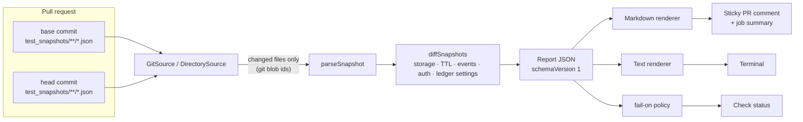

# Snapwise

**Readable pull-request reviews of Soroban test snapshots.**

[](https://github.com/Ike-Nathan/snapwise/actions/workflows/ci.yml)
[](LICENSE)

Every Soroban contract test that uses an `Env` writes a JSON snapshot of the ledger state, the emitted events and the authorization trees to `test_snapshots/`. The [Stellar docs](https://developers.stellar.org/docs/build/guides/testing/differential-tests-with-test-snapshots) recommend committing these files so unexpected side effects show up in review. In practice, a one-line contract change turns into thousands of lines of raw JSON diff, and reviewers skip it. Snapwise reads both versions of every snapshot, works out what actually changed (storage values, TTLs, events, who authorized what), and posts **one readable, sticky comment** on the pull request.

```diff
  CAAA…K3IM authorized CAAA…ITA4.deposit(CAAA…K3IM, 250i128)
-   └ CBUS…IUNF.transfer(CAAA…K3IM, CAAA…ITA4, 250i128)
+   └ CBUS…IUNF.transfer(CAAA…K3IM, CAAA…ITA4, 248i128)
+   └ CBUS…IUNF.transfer(CAAA…K3IM, CAAA…D2KM, 2i128)
```

_Above: Snapwise showing that after a "1% fee" change, depositors now also authorize a second token transfer to the admin. In the raw JSON diff, the same change is spread across a 500-line diff of five files._

## The problem

- **Snapshots are the only record of side effects**, but nobody reads them: they are verbose, unordered from a reviewer's point of view, and full of base64/XDR-shaped JSON.
- **Security-relevant changes hide in them.** A new `require_auth` sub-invocation, a storage entry that is no longer written, or a TTL that is no longer extended are all visible in snapshots and nowhere else in the PR.
- **Generic JSON diff tools don't help.** They don't know that two entries are the same ledger key, that instance storage is a map, or what `{"i128":"250"}` means.

## How it works



Snapwise reads committed snapshots straight from git. It does **not** compile or run your contracts, so the Action finishes in seconds and needs no Rust toolchain. See [docs/how-it-works.md](docs/how-it-works.md) for details.

## Quick start

From a fresh clone, compare the bundled before/after fixtures (a real vault contract, before and after adding a deposit fee):

```sh
git clone https://github.com/Ike-Nathan/snapwise && cd snapwise
npm ci
npm run build
node lib/bin.js diff test/fixtures/vault-fee/base test/fixtures/vault-fee/head
```

In your own contract repo, after running `cargo test`:

```sh
npx github:Ike-Nathan/snapwise diff            # HEAD vs your working tree
```

## GitHub Action

```yaml
# .github/workflows/snapwise.yml
name: Snapwise
on: pull_request
permissions:
  contents: read
  pull-requests: write
jobs:
  review:
    runs-on: ubuntu-latest
    steps:
      - uses: actions/checkout@v7
        with:
          fetch-depth: 0 # Snapwise reads the base commit's snapshots from git
      - uses: Ike-Nathan/snapwise@v0.1.0
        with:
          fail-on: auth # optional: block PRs that change authorization trees
```

Snapwise only reports what is committed. To make sure the committed snapshots match the code, add this step to your existing test job:

```yaml
- run: cargo test
- run: git diff --exit-code -- '**/test_snapshots/**'
```

### What the comment looks like

> ### 🔎 Snapwise: test snapshot review
>
> **5 changed** · 0 added · 0 removed · 0 unchanged
>
> 🔐 auth changed in 5 · 🗄️ storage in 5 · ⏳ TTL in 5 · 📣 events in 1
>
> | Test                                   | Status  | Storage | TTL | Events | Auth     |
> | -------------------------------------- | ------- | ------- | --- | ------ | -------- |
> | `vault › test::deposit_emits_event`    | changed | ~3 +1   | 1   | +4 −2  | ⚠️ +2 −1 |
> | `vault › test::deposit_records_shares` | changed | ~3 +1   | 1   |        | ⚠️ +2 −1 |
>
> Each test then has a collapsible section with a storage table (before/after values and `live_until`), and event and auth diffs.

The full output for this example is in [test/\_\_snapshots\_\_/vault-fee.md](test/__snapshots__/vault-fee.md). _A screenshot of the live comment on the demo PR will be added once the repository is public._

## Configuration

| Action input            | CLI flag           | Default                 | Meaning                                                                                                                  |
| ----------------------- | ------------------ | ----------------------- | ------------------------------------------------------------------------------------------------------------------------ |
| `working-directory`     | `--cwd`            | `.`                     | Directory scanned for `test_snapshots/` folders.                                                                         |
| `base-ref`              | `--base`           | PR base commit / `HEAD` | What to compare from.                                                                                                    |
| `head-ref`              | `--head`           | `HEAD` / working tree   | What to compare to.                                                                                                      |
| `fail-on`               | `--fail-on`        | `none`                  | Fail when snapshots change in these ways: `any`, `auth`, `storage`, `ttl`, `events`, `env`, `added`, `removed`, `error`. |
| `comment`               | n/a                | `true`                  | Post or update the sticky PR comment.                                                                                    |
| `comment-on-no-changes` | n/a                | `false`                 | Also create a comment when nothing changed (an existing one is always updated).                                          |
| `include-nonces`        | `--include-nonces` | `false`                 | Show auth nonce entries, which are hidden as noise.                                                                      |
| `github-token`          | n/a                | `${{ github.token }}`   | Token for the comment; needs `pull-requests: write`.                                                                     |
| n/a                     | `--format`         | `text`                  | `text`, `markdown` or `json`.                                                                                            |
| n/a                     | `--full-addresses` | off                     | Print full strkeys instead of `CAAA…ITA4`.                                                                               |
| n/a                     | `--context`        | `2`                     | Unchanged lines shown around event and auth changes.                                                                     |

Action outputs: `changed`, `added`, `removed`, `auth-changed`, `report-json`, `report-markdown`. Full reference: [docs/configuration.md](docs/configuration.md).

## Status and limitations

Snapwise is **v0.1**: it works end to end on the bundled example and its own CI, and has not yet been used on large production contract suites.

- **Snapshot format verified against soroban-sdk 29.0.1** (protocol 29). The format follows the Stellar XDR JSON encoding, so other recent SDK versions are expected to work, but only 29.0.1 has been tested. Unknown value types are shown as compact JSON, never dropped.
- **Events cover only the last top-level call of each test.** This is how the SDK records snapshots, not a Snapwise choice. To have a call's events reviewed, make it the last call in a test.
- **Snapwise trusts the committed snapshots.** It doesn't run your tests. Use the `git diff --exit-code` step above to keep snapshots honest.
- **Test addresses are positional.** `Address::generate` returns deterministic addresses in creation order, so adding a `generate` call early in a test shifts later addresses and makes many rows look changed.
- **Storage keys are matched exactly.** Renaming a key or enum variant shows as one removal plus one addition.
- **Fork PRs get no comment.** Their token is read-only; the report still appears in the job summary.
- Symbol-led vectors in **storage keys** are displayed as enum variants (`Shares(CAAA…)`), matching how `#[contracttype]` encodes enums. A genuine `Vec<Symbol>` key would display the same way.

## Roadmap

- Contract aliases: name `CAAA…ITA4` as `vault` (auto-detect Stellar Asset Contracts; let users label the rest).
- "Unexpected change" detection: flag tests whose snapshots changed although none of their source files did.
- An optional mode that runs `cargo test` itself and reports stale snapshots.
- Decoded contract errors and diagnostic events where the snapshot includes them.
- Published npm package and a GitHub Marketplace listing.

See the [open issues](https://github.com/Ike-Nathan/snapwise/issues) for the full list. Many are labelled `good first issue`.

## Documentation

- [Architecture](docs/architecture.md)
- [Configuration reference](docs/configuration.md)
- [How it works](docs/how-it-works.md): snapshot format, entry identity, diffing rules
- [Adding an output format or report section](docs/extending.md)
- [Releasing](docs/releasing.md)

## Contributing

Contributions are welcome. Please read [CONTRIBUTING.md](CONTRIBUTING.md) first, and wait to be assigned before starting on an issue. This project follows the [Contributor Covenant](CODE_OF_CONDUCT.md). Report vulnerabilities as described in [SECURITY.md](SECURITY.md).

## License

[Apache-2.0](LICENSE)
