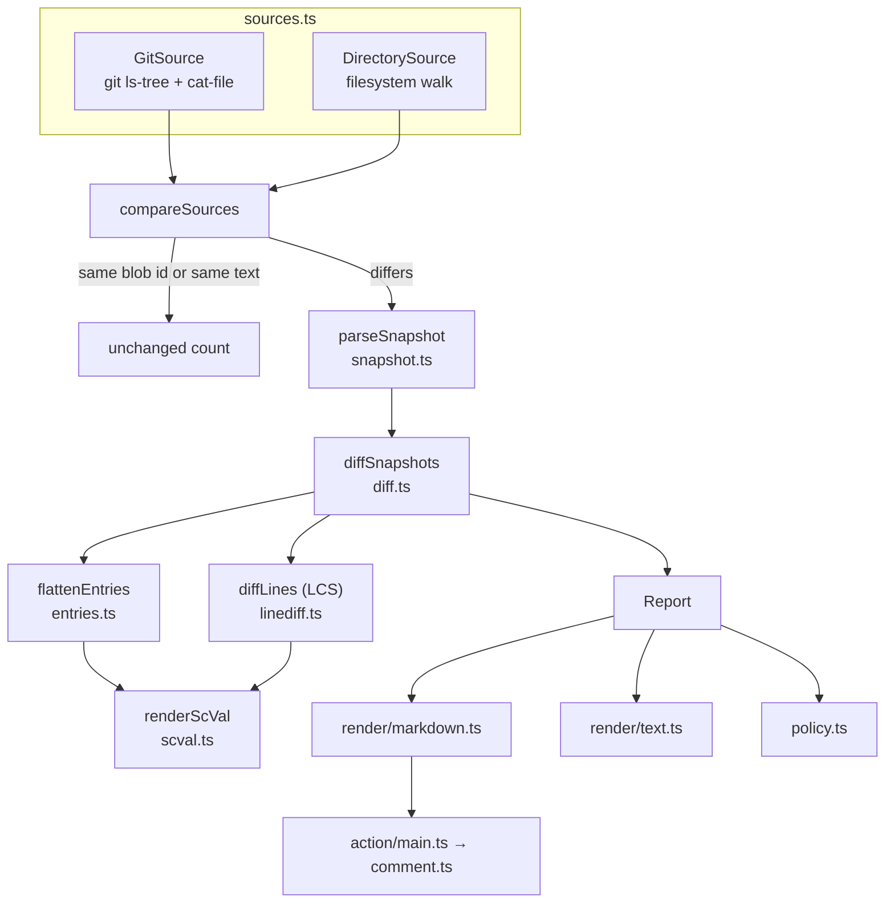

# Architecture

Snapwise is one TypeScript package with three entry points that share the same core:

| Entry point   | File                    | Built to                   | Used by                       |
| ------------- | ----------------------- | -------------------------- | ----------------------------- |
| Library       | `src/index.ts`          | `lib/` (tsc)               | other tools, tests            |
| CLI           | `src/bin.ts` → `cli.ts` | `lib/bin.js` (tsc)         | developers, any CI system     |
| GitHub Action | `src/action/index.ts`   | `dist/index.mjs` (esbuild) | `uses: Ike-Nathan/snapwise@…` |

The library and CLI have **no runtime dependencies**. The Action bundles `@actions/core` and `@actions/github` into `dist/index.mjs`, which is committed so the Action runs without an install step. CI fails if the committed bundle is out of date.

## Data flow

## Modules

| Module              | Responsibility                                                                                                             |
| ------------------- | -------------------------------------------------------------------------------------------------------------------------- |
| `snapshot.ts`       | Types for the SDK's snapshot JSON; `parseSnapshot` validates the minimum Snapwise needs and tolerates unknown fields.      |
| `scval.ts`          | Turns ScVal JSON into short, Rust-flavoured text (`250i128`, `Shares(CAAA…K3IM)`). Has a JSON fallback for unknown shapes. |
| `entries.ts`        | Flattens ledger entries into `FlatEntry` records with a **stable identity** (`id`), label, value and TTL.                  |
| `linediff.ts`       | Longest-common-subsequence line diff, plus hunk context trimming. No dependencies.                                         |
| `diff.ts`           | Diffs two snapshots (storage, TTL, events, auth, ledger settings) and builds the versioned `Report`.                       |
| `sources.ts`        | Where snapshots come from (git commit or directory), path → test name mapping, and `compareSources`.                       |
| `policy.ts`         | `fail-on` parsing and evaluation.                                                                                          |
| `render/*.ts`       | Markdown (PR comment), plain text (terminal) and single-snapshot (`show`) renderers.                                       |
| `action/comment.ts` | Sticky comment logic behind a three-method `CommentApi` interface, so it can be tested without GitHub.                     |
| `action/main.ts`    | Reads Action inputs, resolves base/head, runs the comparison, writes outputs, summary and comment.                         |

## Design decisions

- **Read from git, don't run tests.** Running `cargo test` in the Action would need a Rust toolchain and minutes of build time, and would duplicate the user's existing test job. Snapshots are already committed, so the Action reads both commits with `git cat-file`. Keeping snapshots up to date is the job of the user's own test step (`git diff --exit-code`).
- **Skip unchanged files cheaply.** `GitSource` exposes git blob ids as fingerprints; files with the same blob on both sides are never read or parsed.
- **Semantic, not textual, comparison.** Ledger entries are matched by identity (contract + durability + key), not by position, so reordering is not a change. A file that differs only in formatting or line endings counts as unchanged.
- **A versioned JSON report is the contract between stages.** Renderers and the policy only consume `Report`, so new output formats need no changes to the diff engine. `schemaVersion` is bumped on breaking changes.
- **Never drop data.** Unknown entry types and ScVal variants are rendered as compact JSON. Duplicate identities get a `#2` suffix instead of overwriting each other.
